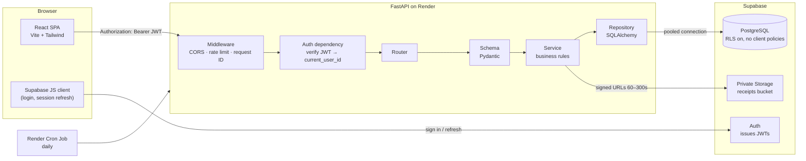

# Expense Tracker — Personal Finance Management System

A full-stack expense tracker: record income and expenses, manage budgets, track
multiple accounts, attach receipts, and understand where your money goes.

**Status: Phase 7 code complete (deployment pending credentials)** — accounts,
categories, transactions, transfers, credit cards, receipts, budgets, dashboard
reporting, CSV exports, recurring bills, notifications and rate limiting are
implemented. Deployment files are ready for Render + Vercel + Supabase.

- Frontend: React (JavaScript/JSX) + Vite + Tailwind CSS + React Router + TanStack Query + Recharts
- Backend: Python + FastAPI + SQLAlchemy 2 + Alembic + Pydantic
- Data: PostgreSQL (Supabase), Supabase Auth, private Supabase Storage

---

## Table of contents

1. [Architecture](#architecture)
2. [Money, refund, transfer and credit-card rules](#money-refund-transfer-and-credit-card-rules)
3. [Repository layout](#repository-layout)
4. [Prerequisites (Windows)](#prerequisites-windows)
5. [Local setup](#local-setup)
6. [Environment variables](#environment-variables)
7. [Supabase setup](#supabase-setup)
8. [Testing](#testing)
9. [Deployment](#deployment)
10. [Feature status](#feature-status)
11. [Known limitations](#known-limitations)
12. [Decisions and deviations](#decisions-and-deviations)

---

## Architecture



**Rules that hold everywhere**

- The frontend is never the source of truth for totals or permissions.
- Only FastAPI talks to PostgreSQL. The browser never queries tables.
- Row-level security is enabled on every table with **no** client policies
  (deny by default); the backend still filters every query by `user_id`.
- Resources belonging to another user return **404**, never 403.

---

## Money, refund, transfer and credit-card rules

These are fixed decisions from the master specification and must not drift.

### Storage

- Amounts are integer **minor units** (`BIGINT`): kobo, cents. `NGN 1,250.50` is stored as `125050`.
- Every amount is **positive**. The transaction `type` carries the direction.
- Each row carries an ISO-4217 `currency_code`; each account has exactly one currency.
- Totals are calculated per currency. **No exchange-rate conversion** in the MVP.
- Formatting happens only in the UI, with `Intl.NumberFormat` (`en-NG`, ₦).
- Floats are never used for money.

### Transaction types

| Type | Effect on account balance | Counted in income | Counted in expenses |
|---|---|---|---|
| `income` | adds | yes | no |
| `expense` | subtracts | no | yes |
| `refund` | adds | no | reduces spending in its category |
| `transfer` | subtracts from source, adds to destination | no | no |

- A `refund` may optionally link to the original expense via `refund_of_id`.
  It reduces category spending, never inflates income.
- A `transfer` is a **single row** with `account_id` (source) and
  `dest_account_id` (destination). Both accounts must belong to the same user
  and share the same currency; cross-currency transfers are rejected.
- Transfers are excluded from all income, expense, budget and report totals.

### Deletion

- Transactions are **soft-deleted** (`deleted_at`). They are excluded from every
  calculation and the deletion is written to `audit_logs`.
- Accounts that have transactions are **archived**, never deleted.
- A category still referenced by a transaction cannot be deleted (409) until
  those transactions are reassigned.

### Credit cards

- A credit-card account's balance represents **money owed** and is negative.
- A purchase on the card is an `expense` on that account.
- A repayment is a `transfer` from a bank/cash account to the card account, so
  it is **never** counted as an expense.
- Credit-card repayment is therefore not double-counted.

### Time

- Timestamps are stored in UTC (`timestamptz`).
- Each transaction also stores `transaction_date` (a DATE in the user's timezone).
- Periods, budgets and reports use the user's timezone (default `Africa/Lagos`).

### Balances and budgets are derived

- Account balance = opening balance + eligible transactions. Calculated by the
  backend; not stored.
- Budget actual spend = expenses − refunds in the budget's category/period,
  excluding transfers and soft-deleted rows. Calculated by the backend; not stored.

### Duplicate protection

- `POST /api/v1/transactions` accepts an `Idempotency-Key` header.
- Keys are unique per user: `UNIQUE (user_id, key)`. Repeating the request
  returns the original result instead of creating a second transaction.
- Scheduled bills are protected by `UNIQUE (recurring_id, due_date)`, so
  running the daily job twice creates no duplicates.

---

## Repository layout

```
Expense Tracker/
├─ frontend/   React + Vite SPA
├─ backend/    FastAPI application, Alembic migrations, tests, cron runner
├─ .github/    CI workflow
├─ render.yaml Render blueprint (API + daily job)
├─ README.md
└─ .gitignore
```

See `frontend/src` and `backend/app` for the detailed module structure.

### Data model

| Group | Tables |
|---|---|
| Identity | `profiles`, `user_preferences` |
| Money movement | `accounts`, `categories`, `transactions`, `tags`, `transaction_tags` |
| Planning | `budgets`, `savings_goals` |
| Recurring | `recurring_transactions`, `bills` |
| Extras | `receipts`, `notifications`, `audit_logs`, `idempotency_keys` |
| Reference | `currencies` |

Every user-owned table carries `user_id` and has RLS enabled with no client
policies. The API is the only writer, and every query filters by the
authenticated user.

---

## Prerequisites (Windows)

| Tool | Version used here | Notes |
|---|---|---|
| Python | **3.13.15** | The spec says 3.12; 3.13 was already installed and the whole stack supports it (see [Decisions](#decisions-and-deviations)). |
| Node.js | 22.17.1 (LTS) | Comes with npm 10.9.2 |
| Git | 2.55 | |
| VS Code | current | Python + ESLint/Tailwind extensions recommended |

Check them:

```powershell
py -3.13 --version
node --version
npm --version
git --version
```

---

## Local setup

### 1. Backend

```powershell
cd "C:\Users\Dell\Downloads\Expense Tracker\backend"
py -3.13 -m venv .venv
.\.venv\Scripts\Activate.ps1
```

If PowerShell blocks activation:

```powershell
Set-ExecutionPolicy -Scope CurrentUser RemoteSigned
```

Then:

```powershell
python -m pip install --upgrade pip
pip install -r requirements.txt
Copy-Item .env.example .env      # then adjust the values (see below)
.\.venv\Scripts\alembic.exe upgrade head
uvicorn app.main:app --reload
```

- Health: http://localhost:8000/health
- Interactive docs: http://localhost:8000/docs

The schema is created by two migrations:

| Revision | Contents |
|---|---|
| `0001` | All 16 tables, indexes and constraints |
| `0002` | Currency seed data and RLS enabled on every table |

**Local database.** Until a Supabase project exists, development uses the local
PostgreSQL 18 instance. Create the two databases once:

```powershell
& "C:\Program Files\PostgreSQL\18\bin\psql.exe" -U postgres -h 127.0.0.1 -c "CREATE DATABASE expense_tracker;"
& "C:\Program Files\PostgreSQL\18\bin\psql.exe" -U postgres -h 127.0.0.1 -c "CREATE DATABASE expense_tracker_test;"
```

Both `.env` files are already configured this way; switching to Supabase only
changes connection strings and auth keys (see [Supabase setup](#supabase-setup)).

### 2. Frontend

In a second terminal:

```powershell
cd "C:\Users\Dell\Downloads\Expense Tracker\frontend"
npm install
Copy-Item .env.example .env
npm run dev
```

Open http://localhost:5173. The status card should show **API online**.

---

## Environment variables

### Backend (`backend/.env`)

| Variable | Purpose |
|---|---|
| `APP_ENV` | `development` or `production` |
| `CORS_ORIGINS` | Comma-separated allowed browser origins |
| `DATABASE_URL` | Supabase **pooled** connection (port 6543), used by the API. Locally: `postgresql+psycopg://postgres@127.0.0.1:5432/expense_tracker` |
| `MIGRATION_DATABASE_URL` | Supabase **direct** connection (port 5432), used by Alembic |
| `TEST_DATABASE_URL` | Separate database used only by `pytest` |
| `SUPABASE_URL` | Project URL |
| `SUPABASE_JWKS_URL` | JWKS endpoint used to verify access tokens (preferred) |
| `SUPABASE_JWT_AUD` | Token audience (default `authenticated`) |
| `SUPABASE_JWT_SECRET` | Legacy HS256 secret. Leave empty for JWKS projects; used locally for throwaway dev tokens |
| `SUPABASE_SERVICE_ROLE_KEY` | Server-only; used for private Storage access. Never sent to the browser |
| `SUPABASE_RECEIPTS_BUCKET` | Private bucket name (default `receipts`) |
| `SIGNED_URL_TTL_SECONDS` | Signed receipt URL lifetime (60–300) |
| `DEFAULT_CURRENCY` / `DEFAULT_TIMEZONE` | Defaults for new users |
| `RATE_LIMIT_DEFAULT` | slowapi default limit |
| `CRON_SECRET` | Shared secret for the daily job endpoint |

### Frontend (`frontend/.env`)

| Variable | Purpose |
|---|---|
| `VITE_API_BASE_URL` | Backend origin, e.g. `http://localhost:8000` (the client adds `/api/v1`) |
| `VITE_SUPABASE_URL` | Project URL (public) |
| `VITE_SUPABASE_ANON_KEY` | Public anon key — the only Supabase key allowed in the browser |

> Secrets never go in `frontend/.env`: Vite inlines `VITE_*` values into the
> public bundle.

---

## Supabase setup

The app runs without Supabase today (local PostgreSQL + a development HS256
secret). When you create the project, swap four values and run the migrations:

1. Create a project at https://supabase.com.
2. **Project Settings → Database → Connection string**:
   - pooled (port `6543`) → `DATABASE_URL`
   - direct (port `5432`) → `MIGRATION_DATABASE_URL`
   - keep the `postgresql+psycopg://` prefix and URL-encode the password.
3. **Project Settings → API**:
   - project URL + anon key → `frontend/.env`
   - JWKS URL `https://<ref>.supabase.co/auth/v1/.well-known/jwks.json` →
     `SUPABASE_JWKS_URL`, and clear `SUPABASE_JWT_SECRET`.
4. **Authentication → URL Configuration**: Site URL `http://localhost:5173`
   and redirect URLs `http://localhost:5173/**` (add the Vercel domain later).
5. **Storage → New bucket**: `receipts`, **private**.
6. Run `.\.venv\Scripts\alembic.exe upgrade head` against the Supabase direct
   connection. Migration `0002` enables RLS on every table.
7. Restart the API and the Vite dev server.

> The service-role key is only used server-side and must never appear in
> `frontend/.env`.

---

## Testing

Backend — requires the local `expense_tracker_test` database (migrations are
applied automatically; user tables are truncated between tests):

```powershell
cd backend
.\.venv\Scripts\Activate.ps1
pytest -q
```

Frontend:

```powershell
cd frontend
npm run test
```

Last verified run:

| Suite | Result |
|---|---|
| Backend (`pytest`) | **88 passed** — auth rejection, profile bootstrap, preferences, isolation, RLS, transactions, receipts, budgets, reports, bills, jobs, notifications, CSV export, data export, account deletion, rate limiting and security headers |
| Frontend (`vitest`) | **27 passed** — theme, route guards, login validation, money parsing, report ranges/date maths and CSV filenames |
| Frontend build | success (entry 620 kB / 186 kB gzip; lazy pages such as Reports split out) |
| Lint | clean (0 warnings) |
| CI | `.github/workflows/ci.yml` runs both suites on every push and PR |

> Test results are only reported in this README after they have actually been
> run. Nothing is claimed as passing before that.

---

## Deployment

Everything needed is in the repository: `render.yaml`, `frontend/vercel.json`
and `.github/workflows/ci.yml`. The API cannot be deployed until the Supabase
database password and host credentials are available (see below).

### 0. Prerequisites

- A Supabase project (database + Auth + a **private** `receipts` bucket).
- A GitHub repository containing this code.
- A Render account (API) and a Vercel account (frontend).

### 1. Migrate the Supabase database

From `backend/`, with the **direct/session** connection string (port `5432`)
in `MIGRATION_DATABASE_URL`:

```powershell
.\.venv\Scripts\alembic.exe upgrade head
```

This creates the 16 tables, seeds currencies and enables RLS. Run it once per
environment; re-running is safe.

### 2. Deploy the API (Render)

1. Push the repo to GitHub.
2. Render → **New → Blueprint** → select the repo. Render reads `render.yaml`.
3. Fill the `sync: false` variables:
   - `DATABASE_URL` — Supabase **transaction pooler**, port `6543`
   - `MIGRATION_DATABASE_URL` — Supabase **session pooler**, port `5432`
   - `CORS_ORIGINS` — the Vercel URL, e.g. `https://expense-tracker.vercel.app`
   - `SUPABASE_URL`, `SUPABASE_JWKS_URL`, `SUPABASE_SERVICE_ROLE_KEY`
   - `API_BASE_URL` (cron service) — `https://<your-api>.onrender.com`
   - `CRON_SECRET` — the same value on both services
4. Deploy. Check `https://<your-api>.onrender.com/health` reports
   `"database": "ok"`.
5. If your Render plan has no cron jobs, keep the web service only and call
   `POST /api/v1/jobs/run` with `X-Cron-Secret` from GitHub Actions or another
   scheduler once a day. `backend/scripts/run_daily_job.py` is a ready runner.

### 3. Deploy the frontend (Vercel)

1. Vercel → **Add New → Project** → import the repo.
2. Set **Root Directory** to `frontend`. Vite is detected automatically.
3. Add environment variables (Production and Preview):
   - `VITE_API_BASE_URL=https://<your-api>.onrender.com`
   - `VITE_SUPABASE_URL=https://<project-ref>.supabase.co`
   - `VITE_SUPABASE_ANON_KEY=<publishable/anon key>`
4. Deploy. `vercel.json` rewrites client-side routes to `index.html` and adds
   security headers.
5. Back in Supabase → **Authentication → URL Configuration**, set the Site URL
   to the Vercel domain and add `https://<vercel-domain>/**` to redirect URLs.
6. Update Render's `CORS_ORIGINS` with the final Vercel domain and redeploy the
   API if it changed.

### 4. Verify

- Register a new account, confirm the email, sign in.
- Add an account and a transaction; check the dashboard totals.
- Upload a receipt and open its signed URL (expires in 5 minutes).
- Create a recurring template, press **Generate due bills**, then pay it.
- Download a CSV and print a report.
- Confirm `/health` stays green and CI passes on GitHub.

> **Blocked on credentials:** the local machine has no Supabase database
> password, no Vercel token and no Render token. Steps 1–3 need those values.


Exact steps are documented in Phase 7.

---

## Feature status

| Area | Status |
|---|---|
| Project structure, tooling, env examples | ✅ Phase 1 |
| Design tokens, light/dark/system theme, no-flash script | ✅ Phase 1 |
| FastAPI app, `/health`, OpenAPI docs, CORS, request IDs | ✅ Phase 1 |
| Database schema (16 tables) + Alembic migrations + RLS | ✅ Phase 2 |
| Supabase Auth, JWT verification, profile bootstrap, isolation | ✅ Phase 2 |
| Login, register, forgot/reset password, route guards | ✅ Phase 2 |
| Settings: name, currency, timezone, theme, sign out | ✅ Phase 2 |
| Settings: notification preferences, JSON data export, account deletion | ✅ Phase 7 |
| Categories, accounts, transactions | ✅ Phase 3 |
| Dashboard totals, budgets | ✅ Phase 4 |
| Transfers, credit cards, receipts | ✅ Phase 5 |
| Reports, CSV export, recurring bills, notifications | ✅ Phase 6 |
| Security review, accessibility, rate limiting, deployment files | ✅ Phase 7 code; deployment ⏳ pending credentials |

---

## Known limitations

- **Supabase Auth is configured; the Supabase database is not.** Development runs
  against local PostgreSQL. The hosted database needs the pooled connection
  strings before it can be migrated and used.
- No sample financial data is displayed anywhere.
- Single currency per account, no FX conversion.
- Bills generate up to seven days ahead (or the template's reminder window, if
  longer). A paused template stops generating new bills but keeps its history.
- Rate limiting is in-process. A multi-instance deployment should point slowapi
  at Redis so limits are shared.
- Account deletion removes all database rows and receipt objects. The Supabase
  Auth user is also deleted when `SUPABASE_SERVICE_ROLE_KEY` is set; otherwise
  the data is removed but the sign-in identity remains.
- Email notifications, OCR, AI insights and bank integration are explicitly out
  of scope. Reports print to PDF through the browser rather than rendering a
  server-side PDF.

---

## Decisions and deviations

| Decision | Reason |
|---|---|
| **Python 3.13** instead of the spec's 3.12 | 3.13.15 was already installed; FastAPI, SQLAlchemy, Alembic, psycopg and Pydantic support it. Verified by running the app. |
| **Tailwind CSS 3.4** (pinned) | The spec's token system uses `tailwind.config.js` + `darkMode: 'class'`; Tailwind 4 changed that setup. Pinning keeps the specified design system exact. |
| **Monorepo** (`frontend/` + `backend/`) | Simplest for a single developer learning full-stack; one history, one CI. |
| **Vite 8 / React 19** | Current defaults from `npm create vite`; no TypeScript template used, per spec. |
| Design colours live only in CSS variables | Guarantees light/dark parity and prevents hardcoded hex values in components. |
| **Local PostgreSQL 18** for development and tests | The Supabase project does not exist yet. The schema is identical; only the connection strings and JWT keys change when Supabase is added. |
| Enums stored as `VARCHAR` and validated by Pydantic | Native PostgreSQL enums are painful to alter, and `native_enum=False` with a CHECK constraint made Alembic emit every constraint twice. Values are validated before they reach the database. |
| Profiles created lazily on first authenticated request | Supabase owns sign-up, so there is no registration hook. The first `GET /api/v1/me` creates the profile and default preferences atomically. |
